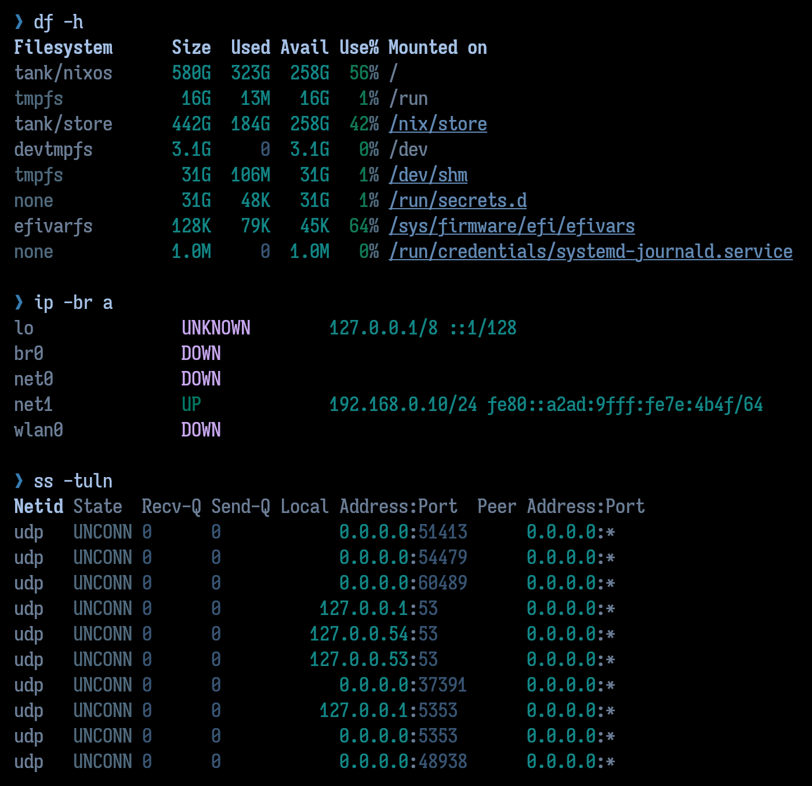
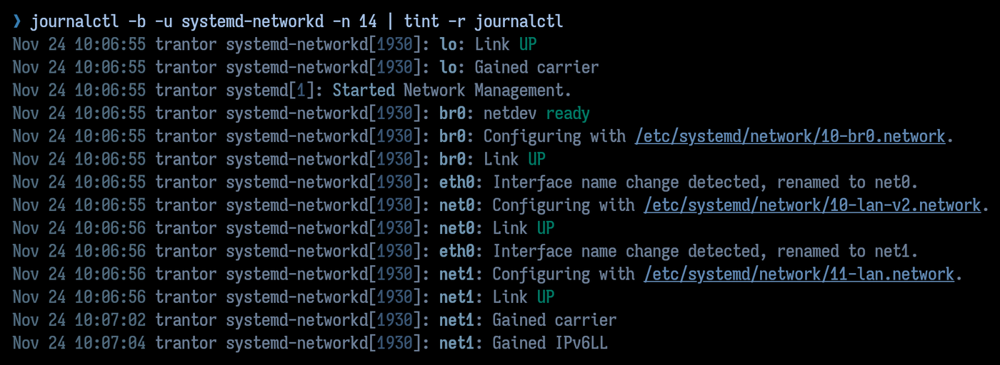
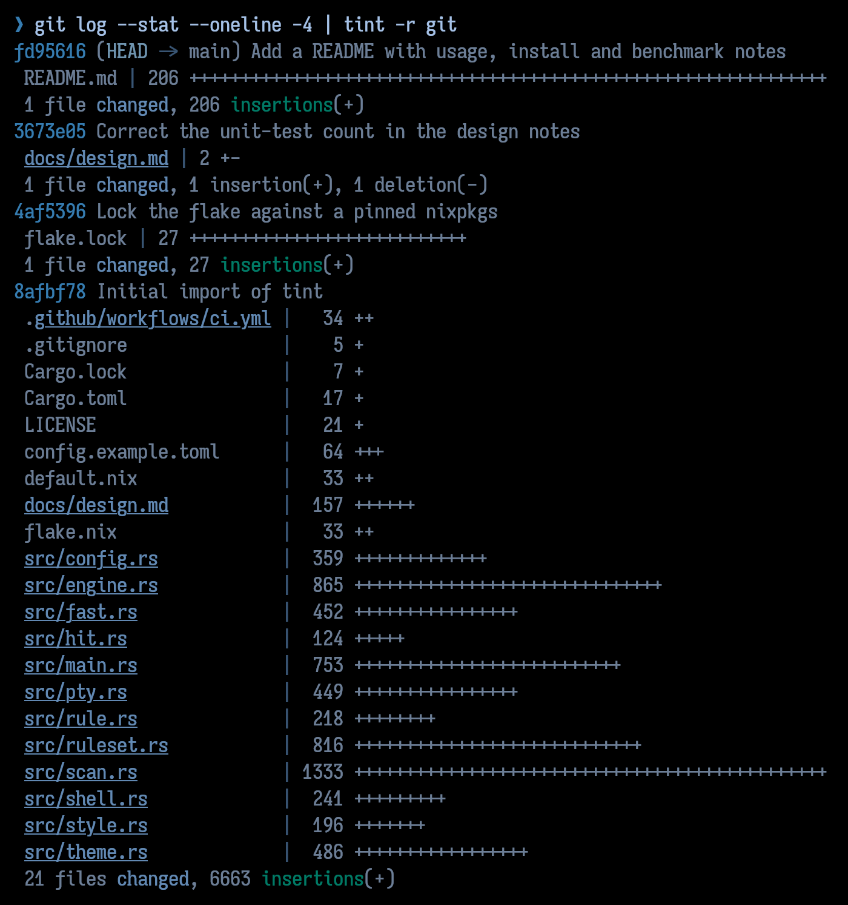

# tint

A fast colouriser for command-line program output. One Rust binary, no crate
dependencies, about a millisecond of startup — so it can sit in front of every
diagnostic command in your shell without turning a 20 ms `df` into a 120 ms one.

```sh
df -h | tint -r df      # colourise a pipeline
tint -- df -h           # or run the command through it
```

[](screenshots/usage.png)

## Why

The classic answers to "make `df` readable" are `grc`, `cope` and `ccat`. All of
them pay a script interpreter per invocation and only know the tools someone
wrote a configuration for. `tint` reads the *shape* of a token first — byte
sizes, percentages with thresholds, durations, temperatures, IPv4/IPv6/MAC
addresses, paths, URLs, timestamps, hashes, `key=value` keys, severity words —
so a program nobody wrote rules for still reads well, and adding a tool is a few
lines of table on top of that.

## How it works

Three layers, cheapest first:

1. **Scanners** classify tokens by their shape with hand-written byte scans (no
   regex, no per-line allocation).
2. **Rulesets** add what is specific to one tool: 37 of them (`df`, `git`,
   `journalctl`, `ss`, `nix`, `kubectl`, `nmap`, ...), each a delta on the
   scanners. `tint --list` shows them, `tint --show df` shows what one compiles.
3. **Themes** map semantic slots (`err`, `warn`, `size`, `path`, `ip`, ...) to
   ANSI styles, so `--theme`, `NO_COLOR` and `TERM=dumb` are a table swap
   instead of a second code path.

Spans never nest: overlapping candidates are dropped after a sort, and the
renderer walks each line once. Bulk input (a file, `nix log | tint`) is
classified in parallel by line, bottom-up to identical bytes; a stream
(`tail -f`, `journalctl -f`, `ping`) is forwarded line by line as it arrives.

Details, including the buffer/threading design and the pty relay, are in
[docs/design.md](docs/design.md).

## Screenshots

Service logs — timestamps, paths, states:

[](screenshots/logs.png)

`git log --oneline | tint -r git` — hashes, refs, conventional prefixes:

[](screenshots/git.png)

All screenshots use the `neg` theme (the author's [neg.nvim](https://github.com/neg-serg/neg.nvim)
palette) in kitty with Iosevka.

## Install

The flake exports the package:

```sh
nix profile install github:neg-serg/tint
nix build github:neg-serg/tint          # ./result/bin/tint
nix run github:neg-serg/tint -- --list
```

In a NixOS or home-manager configuration, take it from the flake's overlay
(`inputs.tint.overlays.default`) or build it straight from source:

```nix
environment.systemPackages = [
  (pkgs.callPackage (fetchTarball "https://github.com/neg-serg/tint/archive/main.tar.gz") { })
];
```

Without Nix, there is nothing to fetch but the compiler:

```sh
git clone https://github.com/neg-serg/tint
cd tint
cargo build --release     # no dependencies
install -m755 target/release/tint ~/.local/bin/
```

## Usage

```
tint [OPTIONS] [--] COMMAND [ARGS...]    run COMMAND, colourise what it prints
tint [OPTIONS] -r RULESET                colourise stdin (a pipeline)
tint --list | --show RULESET | --shell SHELL
```

Options worth knowing:

| Option | What it does |
| --- | --- |
| `-r, --ruleset NAME` | ruleset to use; inferred from `COMMAND` when omitted |
| `-t, --theme NAME` | `dark` (default), `light`, `vivid`, `neg`, `mono`, `none` |
| `--color WHEN` | `auto`, `always`, `never` |
| `--ansi WHEN` | `skip` lines that already carry ANSI (default) or `extend` them |
| `--pty` | give the child a terminal of its own (progress bars, `-it`, REPLs) |
| `--pager` | page the colourised output (`$TINT_PAGER`, `$PAGER`, `less -FRX`) |
| `--stats` | counters and throughput on stderr |

When colour is off — a pipe, `NO_COLOR`, `TERM=dumb` — the wrapper mode `exec`s
the command instead of copying it, so a pipeline pays one `exec` and keeps the
command's own exit code and signal behaviour.

## Shell integration

`tint --shell zsh` prints one guarded function per command in the builtin
wrapper table, so `df`, `ip`, `ss`, `free`, `lsblk`, `dmesg`, `ps`, `sensors`,
`tar`, `nmap` and friends are colourised without typing `tint`:

```sh
# ~/.zshrc
eval "$(tint --shell zsh)"
```

```sh
# ~/.bashrc
eval "$(tint --shell bash)"
```

```fish
# ~/.config/fish/config.fish
tint --shell fish | source
```

`git`, `curl`, `docker`, `kubectl`, `make` and `python` are deliberately *not*
wrapped: they own a pager, an editor or an interactive prompt. Their rulesets
are still there — `git log | tint -r git`.

## Themes

`dark` (the default) paints with the terminal's own 16 colours, so it follows
whatever palette the terminal runs. `neg` is the neg.nvim palette as truecolor;
`vivid` is a brighter 256-colour take; `light` is for light terminals; `mono`
uses attributes only and survives greyscale printing; `none` is a pass-through.

Any slot can be restyled in the config:

```toml
theme = "neg"
theme.style.err = "#cf4f88,bold"
theme.style.path = "idx:33,underline"
```

## Configuration

`~/.config/tint/config.toml` (or `--config PATH`) is a flat TOML subset; see
[config.example.toml](config.example.toml). The keys are deltas on the builtin
behaviour:

```toml
color = "auto"
wrap = "go rustup"            # extra commands to wrap
skip = "find tar"             # never wrap these
pty = "cargo rustc"           # wrap with --pty (terminal of its own)
pager = "journalctl"          # wrap with --pager (`less -FRX`)
keyword.FATAL = "red,bold"    # word rule; a style or a theme slot
prefix.!!! = "brightred"      # line-start rule
suffix.done = "ok"            # line-end rule
"literal.dbg!" = "idx:141"    # anywhere in the line
```

## Performance

Measured on a 9950X3D, 2026-10-21, with hyperfine: 32 MB / 261 303 lines of
`journalctl -b --no-pager` through `tint -r journalctl --color=always`.

| build | wall | user |
| --- | --- | --- |
| single thread (`TINT_THREADS=1`) | 293 ms | 288 ms |
| 16 threads (default) | 84 ms | 369 ms |
| `--color=never` (pure copy) | 4.1 ms | 1.5 ms |

The parallel path buys 3.5x of wall clock and costs 27% more CPU. Startup:
`df -h` 1.1 ms, `tint -- df -h` 1.3 ms, `tint --color=always -- df -h` 1.4 ms,
so a wrapper adds 0.2–0.3 ms to a short command.

## Development

```sh
cargo test        # 70 unit tests
cargo build
nix build .#default
```

| File | Role |
| --- | --- |
| `src/scan.rs` | token classifiers (shape → kind) |
| `src/ruleset.rs` | per-tool deltas and line rules |
| `src/theme.rs` | semantic slots and palettes |
| `src/engine.rs` | rendering, bulk/live input, spans |
| `src/pty.rs` | the `--pty` relay |
| `src/shell.rs` | generated wrapper functions |
| `src/config.rs` | the flat TOML subset |

`screenshots/shoot.sh` takes the README shots in a real kitty window; the demo
scripts next to it are the exact commands in the images.

## License

MIT — see [LICENSE](LICENSE).
